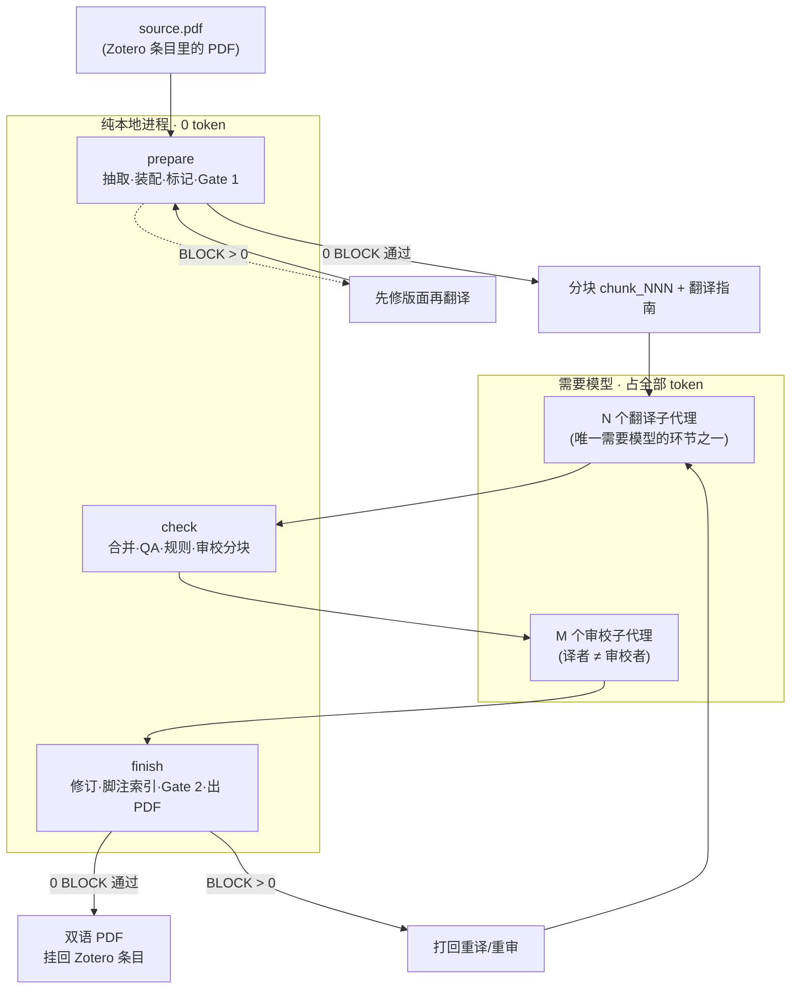

# zoterofanyi · 论文中英对照双语 PDF

把英文学术论文（Zotero 里的 PDF）做成 **「英文段 → 中文段」交错的双语 PDF**：公式与表格原图保留、
脚注独立成块并附编号对照表、每页标注原文页码，最后挂回 Zotero 条目。

不是机翻工具。目标是**能直接读的学术中文**，产出物可高亮、可搜索、可批注、可同步到移动端。

<!-- readme-state:start -->
| 项 | 当前值 |
|---|---|
| 当前版本 | `v2.27` |
| 工程规则 | 1–**83** 条（下一条 84） |
| 黄金测试集 | **16** 个案例，16 PASS |
| 翻译记忆 | **87** 条词级纠正 + **10** 条整句模式 |
| 公开主库 | `github.com/xiaozeng9066/zoterofanyi-skill` |
<!-- readme-state:end -->

> 上表由 `scripts/check_readme.py` 在每次迭代收尾时**强制校验**（版本与 CHANGELOG 一致、
> 案例数与 `fixtures/` 一致、规则编号与 `SKILL.md` 一致）。数字过时 → 提交被 BLOCK。
> 带 `--fix` 可自动刷新状态表里的机械数字；正文中的说明与数字仍需人工同步，
> 但正文里「N 条工程规则」这类表述也会被门禁核对，改状态表不改正文会被拦。

---

## 这是什么 / 不是什么

**是**：一个自迭代的 workBuddy / DSH skill，包含完整流水线（抽取 → 翻译 → 校验 → 渲染 → 挂回）、
83 条实测工程规则、16 个黄金回归案例（本机全强度另 19 案例）、翻译记忆库，以及「每篇论文都要让 skill 变强一点」的迭代协议。
**不是**：不是 pip 包，不是通用 PDF 翻译器。它假设论文有文本层、以英文撰写、需保留版面语义。

## 怎么工作（一张图）



三个阶段里，**只有翻译和审校两批子代理需要模型**（占全部 token）；其余
抽取 / 装配 / 门禁 / 合并 / 索引 / 排版全是本地进程，`pipeline.py` 一条命令跑完、几秒钟、
零 token。两道 preflight 门禁（Gate 1 开译前、Gate 2 交付前）都必须 0 BLOCK，否则打回。

## 产出长什么样

| 项 | 约定 |
|---|---|
| 版式 | 英文段（灰）→ 中文段（黑），成对不跨页断开 |
| 公式 / 表格 | **原图裁切**，绝不重排（重排必错）；表附中文表注与列名对照 |
| 插图 | 取 PDF 内嵌原图 + 译图注，图内文字不译 |
| 脚注 | 独立块「注 N ｜ 原文 p.X」+ 编号对照表 |
| 参考文献 | 不翻译，但不得吞掉其后的附录 |
| 页码锚点 | 每页标「原文 p.X」 |
| 项目备注 | 写进父条目笔记（Zotero 不允许挂附件下） |

## 快速开始

### 1. 安装到用户级 skill 目录

```bash
git clone https://github.com/xiaozeng9066/zoterofanyi-skill.git "$HOME/.workbuddy/skills/zoterofanyi"
```

必须是**用户级**目录（本机所有项目、所有会话可用）；复制进项目目录换工作区就失效。

### 2. 探测环境 + 验证

```bash
python scripts/bootstrap.py      # 一键引导：探测本机环境（GPU/代理/Zotero/git）+ 自动体检资源门禁 + 黄金集
python scripts/gate.py           # 四类门禁统一体检（换机常用 `gate.py resources`，bootstrap 已自动跑过）
python scripts/regression_suite.py --fixtures fixtures   # 应为 15/15 PASS
```

依赖两个独立 Python 环境（主工具需 PyMuPDF，MinerU 处理双栏/表格/公式），
详见 `SETUP.md`。**不要**用系统 Python 直接跑脚本。

### 3. 处理第一篇

把 PDF 放进 `<工作区>/zotero-translate/<条目key>/source.pdf`，然后走三个阶段：

```bash
"$PY" "$S/pipeline.py" prepare --work "$W"     # 抽取→装配→标记→Gate 1→分块→翻译指南
#   派 N 个翻译子代理 → work/chunks/trans_NNN.json
"$PY" "$S/pipeline.py" check   --work "$W"     # 合并→QA→规则→审校分块→必查清单
#   派 M 个审校子代理 → work/fixes/fix_NNN.json
"$PY" "$S/pipeline.py" finish  --work "$W" --out-pdf "$W/xxx_双语.pdf" --label "Author et al., 2026"
```

**不要跳步**：Gate 1 未 0 BLOCK 不许开译，全量二遍审校（译者 ≠ 审校者）不许抽样。

## 仓库结构

| 路径 | 内容 |
|---|---|
| `SKILL.md` | 主文档：何时用、交付约定、流水线、**83 条工程规则**、各版式特例 |
| `WORKBUDDY-ADAPTER.md` | WorkBuddy 工具映射、Bash 版流水线、git / 同步 / 公开库专章 |
| `CHANGELOG.md` | 一行一版；**版本号 = git tag 名** |
| `PORTABILITY.md` | 换电脑：git 同步 + `local_config.json` 本地化 |
| `PUBLIC-RELEASE.md` | 公开化的完整论证与 SOP（数据最小化、干净历史） |
| `GATES.md` | **门禁总纲**：四类门禁（资源/流程/质量/元）单一地图，换机一键体检入口 |
| `PUBLIC-NOTICE.md` | 本公开库的脱敏说明与仓库拓扑 |
| `SETUP.md` / `WINDOWS-INSTALL.md` | 一次性环境准备 / Windows 实测状态 |
| `MIGRATION.md` | 从 DSH 迁移到 WorkBuddy 的记录 |
| `scripts/` | 50+ 脚本：抽取、翻译、校验、渲染、迭代、同步、脱敏；**一键编排 `pipeline.py`**、PDF 回退 `build_pdf_reportlab.py`、`zotero_api.py`（挂回，Zotero 10 Local API） |
| `templates/` | 术语表模板、术语例外表、原文问题表、用量日志模板 |
| `tm/` | 翻译记忆：`term_fixes`（87 条，其中 36 条可注入译前指南、51 条跨词切片仅留档）、`error_patterns`（10 条整句模式） |
| `fixtures/` | 16 个黄金案例（合成数据，可公开；含规则 83 的 `mem_inject`） |
| `fixtures_full/` | 本机全强度真实快照，**gitignored、不入库** |

## 常用命令

| 想做什么 | 命令 |
|---|---|
| 一键编排（三个阶段） | `pipeline.py prepare / check / finish` |
| **门禁统一体检** | `gate.py`（换机 `gate.py resources` 一键查缺啥补啥） |
| 跑全部回归 | `regression_suite.py --fixtures fixtures` |
| 交付前门禁 | `preflight.py --stage full` |
| 术语是否统一 | `term_audit.py` + `templates/term_exceptions.json` |
| 收尾提交 + 推送 | `iterate_commit.py -v vX.Y -m "一句话"` |
| 与云端对齐 | `sync_now.py --start` / `--end` / `--status` |
| 隐私门禁 | `public_sanitize.py --gate` |

（全部脚本都在 `scripts/` 下，带 `--help` 看参数。）

## 质量体系

四层护栏，缺一层就会出现「看起来漂亮但错得离谱」的译文：

1. **两道 preflight 门禁**：开译前 `--stage skeleton`、交付前 `--stage full`，都必须 0 BLOCK。
2. **16 个黄金案例**：改任何 `scripts/` 后必须全绿；有案例由 PASS 变 FAIL 不得合并。
3. **83 条工程规则**：每条都是踩坑换来的，写在 `SKILL.md`，编号只增不改。
4. **翻译记忆**：`tm/term_fixes.json` 记录词级纠正（如 `suggest` 不译「表明」），
   `tm/error_patterns.json` 记录整句模式，`build_memory.py` 增量回流。

上面四层的全景与换机一键体检见 **`GATES.md`**（门禁总纲）与 `gate.py`（统一入口）。

目标函数优先级固定：**准确 → 少错 → 速度 → 成本**。为省钱跳过全量二遍审校、跳过门禁或回归，
属于违规操作，不是「优化」。

## 迭代：这个仓库为什么一直在变

每处理完一篇论文，必须走完迭代协议（`WORKBUDDY-ADAPTER.md` 第 3 节），
且**必须改文件**——只在对话里总结不算迭代：

1. 归类本次 FAIL / WARN：尺子错 / 译文错 / 原文问题 / 新版面特性；
2. 尺子错 → 修检查器；新版面 → 新增编号规则；
3. `build_memory.py` 增量回流 `tm/`；原文问题写 `reports/source_issues.md`；
4. `snapshot_case.py` 新增案例（full + extract 各一）；
5. `CHANGELOG.md` 追加一版（四指标实测）；
6. 更新本 README 的状态表与相关章节（`check_readme.py` 会拦）；
7. `iterate_commit.py -v vX.Y -m "..."` —— 门禁全过后提交并打 annotated tag，默认推送云端。

门禁包含：版本号格式、CHANGELOG 同版本条目、有实际文件改动、黄金集全绿、tag 不重复、
公开模式下隐私检查通过。**没有 commit hash 不算迭代完成。**
历史只追加：禁止 `amend` / `tag -f` / `reset --hard` / `push --force`；回滚用 `git revert`。

## 跨机与网络

- 版本资产走 git；本机差异只写 `local_config.json`（**不入库**）。
- 换机：`git clone` → `python scripts/bootstrap.py`（自动跑完 `detect_env` → 资源门禁体检 → 黄金集，
  报告里「[资源门禁] 未就绪 N 项」直接告诉你缺什么）。照「下一步」补齐即可，无需记得再跑 `gate.py`。
- 国内网络下 GitHub 一律走代理：`detect_env.py` 探测本机代理端口写 `network.proxy_candidates`，
  `sync_now.py` 逐端点重试，`--json` 里的 `endpoint` 说明本次实际用了哪个。
  **换端口不等于绕过代理**；`degraded: true` 表示发生了应急降级，属异常路径。
- 同步是否成功只看 `ls-remote` 回读，不看命令退出码，也不看「网页能不能打开」。

## 隐私与公开边界

本库是**脱敏公开版**：

- `fixtures/` 全部为合成句，保留结构与断言锚点，不含任何已发表论文正文；
- `tm/` 中整句对照已截断为短摘要；作者邮箱统一替换为 `author@example.org`；
- `PUBLIC-MODE.json` 开启**每次提交**的隐私门禁（`public_sanitize.py --gate`），
  `fixtures/` 或 `tm/` 混入真实正文即 BLOCK，不受 `--skip-regression` 影响；
- 真实全强度快照只在本机 `fixtures_full/`，已被 `.gitignore` 排除；
- 论文原文与译文的版权归原作者 / 译者，本库不附带原文 PDF。

禁止：删除门禁标记、修改 `mode`、把真实快照写回 `fixtures/`、把 `local_config.json` 提交入库。

## 常见坑（都是实测）

| 现象 | 原因 | 处理 |
|---|---|---|
| `import pymupdf` 失败 | 用了系统 Python | 一律用 `paths.py` 给出的 `$PY` |
| 中文复制出来是方框/乱码 | 缺 ToUnicode | `build_pdf.py` 自带校验，非 0 退出即未通过 |
| 附录被标成「不翻译」 | 参考文献终止判定过宽 | 看规则 13，核对 `no_translate` 反向检查 |
| 数字比对大面积 FAIL | 尺子错，不是译文错 | 先自证；见规则 18、23、24 |
| 同步报离线但网页能开 | 代理端点漂移 / 502 | `sync_now.py --status --route proxy`，看 `proxy_candidates` |
| 笔记挂不上 | 挂到了附件 | Zotero 笔记只能挂父条目 |
| 换电脑脚本全报路径错 | 未生成本机配置 | `bootstrap.py` → `paths.py --shell` |

## 文档地图

```
入门    README.md（本文）→ SKILL.md「何时用 / 交付约定 / 流水线」
落地    WORKBUDDY-ADAPTER.md（工具映射、命令、迭代七步）
换机    PORTABILITY.md → SETUP.md / WINDOWS-INSTALL.md
历史    CHANGELOG.md（版本号 = tag 名）
公开    PUBLIC-NOTICE.md → PUBLIC-RELEASE.md
```

## 许可与边界

本仓库**未附带开源许可证**，默认保留所有权利：可阅读、可 fork 参考实现思路，
商业再分发或作为服务提供前请先联系作者。`fixtures/` 为自造合成数据，可自由用于测试。
如希望正式开源，请自行添加 `LICENSE`（例如 MIT），并在本节同步更新。

---

维护约定：本文件与代码同源、同版本。任何让「怎么用」发生变化的改动，
必须在同一次迭代里更新本文件——`check_readme.py` 会拦下过时的数字，
但**说明文字的正确性仍然只能靠人**。
